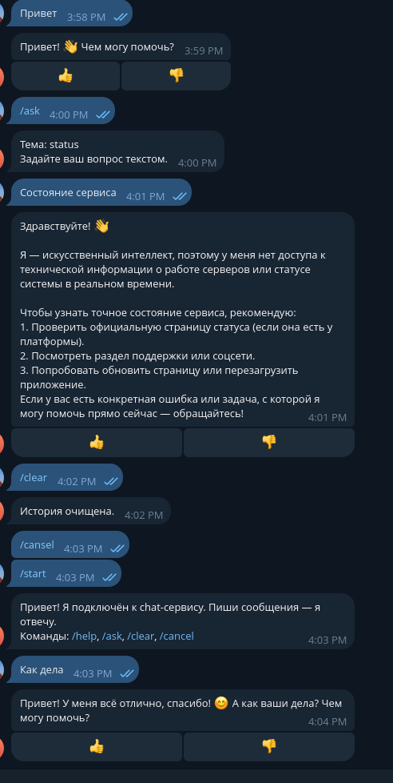

# Блок 4.2 - Telegram-бот как тонкий клиен
---
## [Репозиторий с работой](https://github.com/DimOsSpb/AI-Dev-Diploma/tree/v0.4.2)
## Результаты

- Бот адаптирован для работы с telegram через мой proxy

1. Telegram



2. Bot
```bash
(diploma) odv@matebook16s:~/project/MY/Netology-AI-Dev/Diploma$ uv run -m bot
2026-07-06 17:27:48,900 INFO bot Bot starting (backend=http://localhost:8000)
2026-07-06 17:27:48,900 INFO aiogram.dispatcher Start polling
2026-07-06 17:27:49,170 INFO aiogram.dispatcher Run polling for bot @ai_assistant_9876658_bot id=8904895258 - 'My AI Assistant'
2026-07-06 17:27:58,410 INFO httpx HTTP Request: POST http://localhost:8000/chats "HTTP/1.1 200 OK"
2026-07-06 17:27:58,642 INFO httpx HTTP Request: POST http://localhost:8000/chats/e6fc062e-3e7b-408f-aa49-5e04f519fa7c/messages "HTTP/1.1 200 OK"
2026-07-06 17:28:32,038 INFO aiogram.event Update id=591134736 is handled. Duration 102 ms by bot id=8904895258
```

3. Tests
```bash
(diploma) odv@matebook16s:~/project/MY/Netology-AI-Dev/Diploma$ cd /home/odv/project/MY/Netology-AI-Dev/Diploma && python -m pytest tests/bot/test_fsm.py -v
===================================================================== test session starts ======================================================================
platform linux -- Python 3.13.5, pytest-9.1.1, pluggy-1.6.0 -- /home/odv/project/MY/Netology-AI-Dev/Diploma/.venv/bin/python
cachedir: .pytest_cache
rootdir: /home/odv/project/MY/Netology-AI-Dev/Diploma
configfile: pyproject.toml
plugins: anyio-4.14.0, langsmith-0.9.4, asyncio-1.4.0
asyncio: mode=Mode.AUTO, debug=False, asyncio_default_fixture_loop_scope=None, asyncio_default_test_loop_scope=function
collected 4 items

tests/bot/test_fsm.py::test_ask_flow_states_exist PASSED                                                                                                 [ 25%]
tests/bot/test_fsm.py::test_state_transitions PASSED                                                                                                     [ 50%]
tests/bot/test_fsm.py::test_topics_kb_has_buttons PASSED                                                                                                 [ 75%]
tests/bot/test_fsm.py::test_topics_kb_accepts_custom_topics PASSED                                                                                       [100%]

====================================================================== 4 passed in 5.99s =======================================================================
(diploma) odv@matebook16s:~/project/MY/Netology-AI-Dev/Diploma$ cd /home/odv/project/MY/Netology-AI-Dev/Diploma && python -m pytest tests/bot/test_backend_client.py -v
===================================================================== test session starts ======================================================================
platform linux -- Python 3.13.5, pytest-9.1.1, pluggy-1.6.0 -- /home/odv/project/MY/Netology-AI-Dev/Diploma/.venv/bin/python
cachedir: .pytest_cache
rootdir: /home/odv/project/MY/Netology-AI-Dev/Diploma
configfile: pyproject.toml
plugins: anyio-4.14.0, langsmith-0.9.4, asyncio-1.4.0
asyncio: mode=Mode.AUTO, debug=False, asyncio_default_fixture_loop_scope=None, asyncio_default_test_loop_scope=function
collected 3 items

tests/bot/test_backend_client.py::test_get_or_create_chat PASSED                                                                                         [ 33%]
tests/bot/test_backend_client.py::test_send_message_parses_sse PASSED                                                                                    [ 66%]
tests/bot/test_backend_client.py::test_send_message_yields_message_saved_event PASSED                                                                    [100%]

====================================================================== 3 passed in 0.04s =======================================================================
(diploma) odv@matebook16s:~/project/MY/Netology-AI-Dev/Diploma$
```
